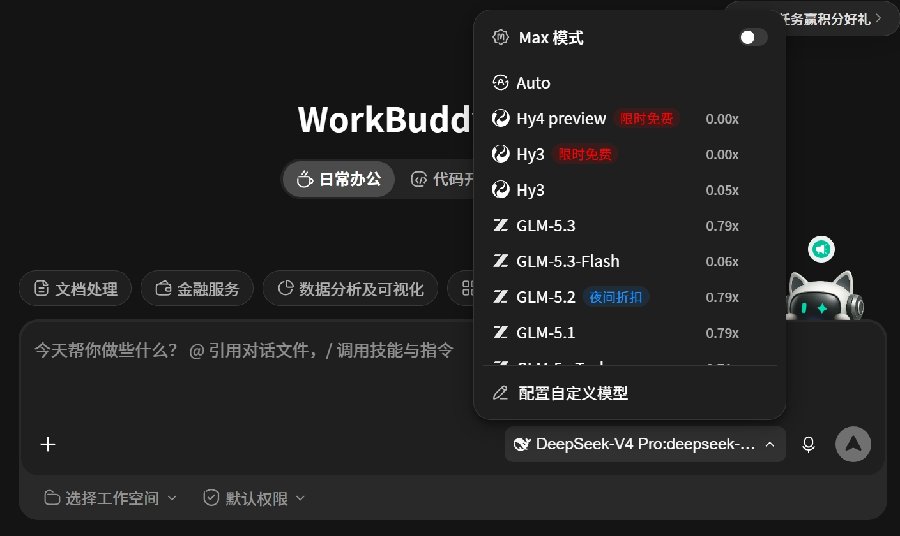

# Agent手册、提示词模板及后话

> *这篇文章旨在用尽可能精炼的语言描述一些个人对于agent的使用和心得。不会出现过多的专业术语 并且 会配图或配视频辅助实操学习，放心食用。（部分内容为了更方便理解，和最准确的专业释义略有差异，但不影响学可学习性）。办公类Agent以Work Buddy作为展示对象，其他国内应用基本上方式一致；另外展示部分以实际撰写内容为准。*
> 
> 


## **0\.基础概念**

> 该部分主要面向刚开始接触AI的纯小白，已经了解相关概念的阅读者可以直接跳过。
> 
> 

### **0\.1 人工智能理念**

研究人类思维活动的规律,构建能模拟人类智能行为的机器,探索学习、延伸和扩展人类智能的方法和技术。（可能不是那么直观，我会用另外一种方式从底部开始拆解这是什么意思）


#### **函数是什么**

首先，我们要理解**函数**是什么。每一个函数其实都是在反应一种**映射关系**，比如我们初高中时候学习到的 f\(x\)。 

> 就拿f\(x\)=3x\+2 这个函数打比方，代表的是输出值 f\(x\)和 输入值x之间的关系
> 
> 

当我们有一个 输入值，比如说x=5。 f\(x\)=3x\+2 阐述了 输入x=5 ，先对于这个输入值 乘以3 再加上 2，就得到了输出值 17。


#### **“人是函数”**

那么我们通过这个具象的例子，就可以开始抽象的理解 “每一个函数其实都是在反应一种**映射关系**” 这句话的意思了。根据这句话的意思呢，尝试理解 每个人都是 “某个函数的处理器” 。比如说 当输入是臭味的时候 人类的输出就是捂鼻子 并伴随输出一些奇怪表情；当发工资的时候，大脑会输出开心这种情绪；被领导无缘无故骂了，大脑会输出生气、委屈，面部表情也会有一定程度的输出。


#### **“人是函数”，所以？**

当我们开始用函数来概括人类行为以后，就会产生一个问题：“当我们能够总结人这种函数的具体表达式的时候，那是不是有一种机器 可以使用计算的方式来预测 或者说 延展人类肉体缺陷所无法完成的事情？”。由此，人工智能的理念就诞生了。


### **0\.2 模型：AI 负责理解和生成内容的大脑**

#### **从“知道公式”到“找出规律”**

前面我们提到了f\(x\)=3x\+2。这个例子里，我们已经知道了怎么算，只要把输入值放进去，就能得到输出值。实际上，某一段时期的人工智能确实是这样设计的，但是发现最终的产物根本行不通。（具体理论不在此阐述）

那么，我们换个角度。如果只知道一些输入和输出，却不知道中间的计算规则，怎么办？

比如，现在有这么几组记录：

|输入|输出|
|---|---|
|1|5|
|2|8|
|3|11|

为了方便理解，我们先限定一下：这里的规则就是“先乘一个数，再加一个数”，只是暂时不知道这两个数分别是多少。

观察以后，你可能会发现：“先乘以 3，再加上 2，就能对上这些结果。”

那么，**既然人可以通过观察例子找出规律，能不能让计算机也来做这件事？**


#### **模型是怎么来的**

我们可以先给计算机一套能够调整的计算规则，让它根据输入算出结果，再看看这个结果和我们提供的答案差了多少。

算得不对，就调整里面的数字，再算一次。经过反复比较和调整，让计算结果尽量接近我们提供的答案。

这个不断调整的过程，就叫作**训练**。经过训练以后，得到的这套能够处理输入、给出输出的计算规则，就可以理解成一个**训练好的模型**。

当然，现实中的问题往往复杂得多。比如，一张照片里面有没有猫，一段话表达的是开心还是生气，都很难用“乘以 3，再加上 2”这样的简单规则描述清楚。模型里面需要调整的数字、需要进行的计算，也会复杂很多。

但我们可以先抓住这个思路：从已有的例子中学习规律，再尝试用这些规律处理新的输入。


#### **这个“函数”，怎么就能聊天了？**

前面的输入是数字。现在，我们把输入换成一句话：

> 帮我写一段请假说明，下周五要搬家，需要请一天假。
> 
> 

我们平时用来聊天、写文章的模型，可以沿着同样的思路理解。它在训练过程中接触了大量文字，从中学习词语怎样搭配、句子怎样组织，以及不同内容之间有哪些联系。

当你把这句话输入进去以后，它会结合你的要求和已经看到的内容，一步步生成接下来的文字，最后形成一段完整的请假说明。语言模型生成文字的基本过程，就可以这样理解。

从我们使用者的角度看，输入是一句要求，输出是一段请假说明。中间负责处理这些信息、组织回答的，就是模型。

（这里为了方便理解，省略了计算机如何把文字变成数字、再进行计算的过程，暂时不用纠结；此外，也仅使用语言模型举例，其他类型的模型不在此做阐述。）


#### **为什么把模型叫作“大脑”**

因为在这个过程中，理解你想做什么、从材料里找到重点、组织出合适的内容，主要依靠模型来完成。所以，我们可以把它比作 AI 负责理解和生成内容的“大脑”。

但是，如果我们希望它写完请假说明以后，还能打开办公软件、找到请假入口、填写表单，那么就需要给这个“大脑”配上能够实际操作的躯干，并把这些步骤衔接起来。


### **0\.3 Harness：让 AI 的“大脑”能够持续干活的躯干**

> 豆包工作、Workbuddy等办公产品，本质上都是harness，你开箱即用是因为配置了默认模型
> 
> 


前面我们提到，模型可以根据你的要求，生成一段请假说明。那么，我们再把要求往前推一步：

> 帮我找到电脑里的请假模板，按照模板填写下周五搬家的请假申请，再保存成一份文档。
> 
> 

这时候，需要完成的事情就多了。它得先找到文件，打开看看里面有什么，再填写内容，最后把文件保存到指定位置。

模型可以判断这些事情应该怎么做。但真正读取文件、修改内容、保存文档，需要由相应的工具来执行。

那么，**模型怎么使用这些工具？工具做完以后，模型又怎么知道结果？** 这些步骤之间，就需要有一套程序来衔接。


#### **Harness 是什么**

我们可以把 Harness 理解成：**围绕模型搭建的一套配套程序**，负责把材料交给模型、安排工具执行操作，再把结果交回来，让任务能够一步一步往下进行。 
如果说模型像一个人的“大脑”，那么 Harness 就有点像为这个人准备好的工作设施和工作安排。需要的资料怎么拿过来，工具怎么使用，做完一步以后怎么接着做，都需要把这些事情安排好。


#### **它具体是怎么工作的**

还是拿刚才的请假申请举例。

1. 模型收到任务以后，可能会判断：“我得先看看请假模板里面有哪些内容。” 于是，它提出读取文件的要求。Harness 接到这个要求以后，就调用读取文件的工具，再把读到的内容交给模型。

2. 模型看到模板以后，发现需要填写姓名、请假时间和请假原因，就可以根据已有信息组织内容。如果缺少姓名，它也可能先问你，而不是直接往下填写。

3. 等内容准备好了，模型再提出生成文档的要求。Harness 就安排相应工具去执行，然后把保存成功、保存位置，或者执行失败的结果交回来。


#### **大家的AI产品，为什么用起来会不一样**

> 理解了这些以后，我们就能解释一个实际使用中可能遇到的现象：为什么同事使用的也是AI，但是和我对于同一个任务的产出天差地别。
> 
> 

原因有多个，跟这个板块相关的原因有两个（当然，还有提示词、本地记忆、skill之类的差异，后续章节会讲）

1. Harness产品差异：一个产品能顺利读取模板、保存文件，操作失败以后还能继续处理；另一个产品可能没有提供相应工具，或者没把前后步骤衔接好。（例如豆包工作处理飞书文档的效果，由于开发团队的权限差异，就大概率优于Work Buddy；对于企业微信则反之）

2. 模型配置差异：同一个任务，使用的模型不同，或者允许它投入的思考程度不同，完成速度、成本和结果的细致程度都可能不一样。比如改一段请假说明，快速配置通常就够用；但要从几十份文件里核对信息，就更适合使用擅长复杂分析的模型，并允许它进行更充分的思考。（现在来说对于一些不需要分析的任务，基本上模型差异不大，更多的是考虑性价比，部分办公产品配置方法会在后文提及）




## **1\.Agent基础上手说明**

> 部分说明为个人使用体感，并不代表各垂类行业使用方式，仅供参考
> 
> 

### **1\.0 写在方法论前**

#### 叠甲声明

（1）此文对于模型能力、办公AI产品的能力点评 不代表任何专业方面的口径，仅作为作者在不同任务流程中的操作体验。（对于海内外的模型、训练范式点评更不代表个人的政治、文化立场）

（2）此文中会涉及到一些工具、网站的分享，请阅读者绿色使用；阅读者任何程度的非绿色使用与作者无关。

（3）本文所有内容系知识、经验分享，作者许诺不对于文章内容出于任何商业目的传播。

（4）任何AI相关的话题讨论均受作者欢迎，详情请联系微信：AidenLreborn2003


#### 魔法推荐（仅绿色使用，使用海外AI产品的前置准备）

点击 ‘立即购买’ 显示无法访问使用该链接：https://justmysocks6\.net/members/

> LA 500 已经很够日常的使用了，如非必要 不用考虑LA 1000
> 
> 

（1）购买订阅后，找到 **subscription link **

（2）下载该安装包（根据自己的电脑进行下载包选择），使用订阅链接登录，复制（1）中的 **subscription link **粘贴并点击登录


Windows安装包：

[jamjams\-0\.2\.1\-installer\.exe](https://github.com/SNG-Commorai/agent-handbook/releases/download/tutorial-assets-20260928/jamjams-0.2.1-installer.exe)

Mac安装包

[Jamjams\-2\.4\.4\.dmg](https://github.com/SNG-Commorai/agent-handbook/releases/download/tutorial-assets-20260928/Jamjams-2.4.4.dmg)


### 1\.1 Agent工作区规划及各场景使用提示词

> 常用任务及基础设置
> 
> 


前面我们聊了一些基础概念，从这一节开始，我们正式进入实际使用的部分。

在给 Agent 安排任务之前，需要两样东西：一个专门存放项目资料的文件夹，以及一套工作要求。（如果你不想你电脑被各种任务弄的非常乱，或者你每次都不知道它到底给你改动了什么的话）

前者用来存放资料和成果，后者用来规范Agent的行为。

假如你正在用 Agent 做一个项目，缺失前者就会导致：今天整理目录，明天补充正文，后天修改配图。这些内容分散在不同的文件夹和对话里，过一段时间再继续，你就需要重新寻找资料、确认版本、解释进度；缺失后者就会导致：agent每天凭心情给你做，比如如果你在做一个作品 让它帮你润色，它每天润色的工具、风格都不一样的话，你肯定受不了的。

所以，必须安排好：**资料放在哪里，成果去哪里找，任务进度如何记录。**


#### 1\.1\.1 为工作建立一个专用文件夹

如果你使用Agent的场景基本偏好一致（只要你不是天天换工作 都可以考虑用这个结构）


```Plain Text

├── 项目说明及边界.md
├── 工作资料/
├── 工作项目/
│   └── 项目1/
└── 任务记录.md
```


使用方法：

在首次使用（其实用了一段时间也无所谓，可以做完结构让Agent把历史的项目资料整理进去），将下面的提示词发给Agent\-\-\-

```Markdown
请帮我建立一个长期使用的工作区，用于存放工作资料、开展不同项目，并保留每次任务的记录。

如果当前文件夹已经有内容，请在保留原有资料的基础上整理，不要直接清空或重新覆盖。

## 一、建立工作区结构

请在我指定并授权的文件夹中，检查并建立以下结构：

工作区/
├── 项目说明及边界.md
├── 工作资料/
├── 工作项目/
│   └── 项目1/
└── 任务记录.md

如果同名文件或文件夹已经存在，先读取或检查，只补充缺少的内容，不要覆盖已有内容。

“项目1”只是示例名称。已有明确项目时，使用实际项目名称；尚未确定项目时，只建立“工作项目”文件夹，不必创建空的示例项目。

## 二、明确各位置的用途

### 项目说明及边界.md

这是整个工作区的统一说明，不只对应某一个项目。

请根据我已经明确提供的信息，整理：
- 这个工作区主要用于什么工作。
- 我经常需要处理哪些任务。
- 我对语言、写作风格、交付格式等有哪些偏好。
- 文件应该如何存放。
- 哪些操作需要先征求我的确认。
- 每次任务应该如何留下记录。

没有明确的信息标注“待补充”，不要把你的猜测当成我的要求。

请把本次提示词中的文件管理、操作边界和任务留痕规则也写入这个文件，不要只在聊天中回复。

### 工作资料/

存放我提供的原始资料和需要反复参考的材料。

原始文件默认保留原样，不直接修改。需要加工或修改时，先复制到对应项目文件夹中再处理。

资料较多时，可以按项目或主题建立子文件夹，不要混放不同项目的资料。

### 工作项目/

每个独立项目建立一个单独的文件夹，使用能够看懂的项目名称。

该项目的需求整理、阅读笔记、草稿、中间版本和交付成果，都放在自己的项目文件夹中。

新任务属于已有项目时，继续使用原来的项目文件夹，不要每次都重新建一个项目。

### 任务记录.md

这是整个工作区共用的任务记录。

每条记录必须注明所属项目。初始化、整理文件等不属于具体项目的任务，统一标为“工作区维护”。

记录按时间追加，不得用本次记录覆盖历史记录。

## 三、遵守文件管理和操作边界

1. 只处理我授权范围内、与当前任务有关的文件，不擅自整理其他位置或其他项目。
2. 项目说明、工作记录、整理笔记和文字草稿统一使用 Markdown（.md）格式。
3. 原始资料保留原格式；交付成果有明确格式要求时，按具体要求输出。
4. 文件命名应能看出内容和版本，例如“活动方案_v01.md”“活动方案_v02.md”，避免使用无法区分的“最终版”。
5. 修改已有成果时，优先另存新版本。删除文件、覆盖已有内容、移动原始资料或向外部发送资料前，先获得我的明确确认。
6. 资料或要求缺失时，说明缺少什么；能够继续完成的部分先做，无法确定的内容标注“待确认”，不要自行编造。

## 四、整理已有的历史项目

如果工作区或我另外指定的范围内已经有历史资料，请先检查实际可访问的内容，列出整理方案，说明：
- 识别出了哪些项目。
- 哪些文件属于原始资料。
- 哪些文件属于草稿、过程文件或成果。
- 准备分别放到哪里。
- 哪些文件暂时无法判断用途或归属。

经我确认后，再进行整理。

默认采用复制归档的方式，保留原文件的位置和内容。遇到同名文件，不直接覆盖；遇到疑似重复文件，不擅自删除。

不要假设你能看到我以前所有的对话或文件。无法访问的历史资料，直接说明，不要声称已经整理。

## 五、每次任务都必须留痕

### 开始前
读取“项目说明及边界.md”，查看“任务记录.md”中与当前项目有关的最近记录，必要时检查已有成果，确认从哪里继续。

### 开始时
在“任务记录.md”中追加本次任务的开始记录，写明时间、所属项目、本次目标、重要要求和“进行中”状态。

### 进行中
长任务完成关键步骤后，保存阶段成果，并追加简短进度记录。
小任务可以只保留开始和结束记录，不需要记录每一个细小操作。

### 结束时
追加本次任务的结束记录，包括：
- 所属项目和任务名称。
- 实际完成了什么。
- 使用了哪些主要资料。
- 新增或修改了哪些文件，以及相对于工作区的路径。
- 实际做过哪些检查，结果如何。
- 还有哪些未完成事项、问题或待确认内容。
- 下一步建议。

状态必须如实填写，例如“已完成”“部分完成”“等待确认”或“失败”。

没有生成文件的任务，也要记录实际结果。任务失败或暂停时，在能够写入记录的情况下，说明停在哪里。

只记录真实发生的操作和结果：没有读取的资料不能写成已读取，没有执行的操作不能写成已完成，没有做过的检查不能写成已通过。不要在记录中写入密码、密钥等敏感信息。

## 六、完成初始化并反馈

请将本次工作区初始化也记入“任务记录.md”。

完成后，简要告诉我：
- 实际创建、沿用或补充了哪些文件和文件夹。
- 哪些规则已经写入“项目说明及边界.md”。
- 是否发现历史资料，以及有哪些整理建议。
- 是否还有需要我补充或确认的信息。

如果没有文件读写权限，请明确说明，并提供需要我手动保存的 Markdown 内容，不要声称文件已经创建或保存。
```


#### 1\.1\.2 为Agent配置跟你工作相关的Skill

> 技能来源：skills\.sh
> 
> 

Skill可以简单理解为：针对某一类任务，提前准备好的一套操作说明，有时还会附带模板、参考资料和小工具。Agent 在处理相关任务时，可以读取这些内容，按照其中的方法开展工作。（和人类的技能很相似，比如说我按照某个流程做ppt 一直做的很好，那我就把这个流程写成说明书，变成可以传播的技能。）

比如，“做一份报告”，我们不仅希望它把文字写出来，还希望它知道如何组织文档、处理表格、检查排版。技能就是用来补充这些具体做法的。


**先看你经常做什么，再决定配置什么技能**

skills\.sh 是一个查找 Agent 技能的目录，可以在里面浏览技能、查看说明，并找到对应的安装方式。

不过，我们不需要一上来就把技能装满。建议先从自己最常做的两三类工作入手：经常处理什么文件？需要交付什么成果？哪些步骤总是需要反复提醒 Agent？

直接一句话让Agent使用

例如：帮我安装[https://www\.skills\.sh/anthropics/skills/docx](https://www.skills.sh/anthropics/skills/docx)并且使用这个技能完成\<描述你的任务\>


**如果以上的skill不足以覆盖你的经常做的事情，可以直接复制以下这两段提示词 ****填写以后 ****发给Agent**

```Markdown
请帮我为当前 Agent 配置与日常工作相关的技能。先检查现有能力并提出方案，经我确认后再安装。

请先读取工作区中的“项目说明及边界.md”，遵守已有工作要求，并按照约定在“任务记录.md”中留下记录。

## 我的工作情况

我主要从事的工作：
【填写你的工作内容】

我经常需要完成的任务：
【例如：整理参考资料、撰写报告、处理表格、制作汇报演示文稿】

我最希望改善的问题：
【例如：文档格式不统一、数据整理步骤重复、每次都要重新交代工作方法】

技能查找来源：
https://www.skills.sh/

## 第一步：检查当前环境

确认当前使用的 Agent 是否支持安装和使用这些技能，以及实际支持的安装方式。

查看当前已有的技能和工具。如果已有能力能够满足需求，优先沿用，不重复安装功能相近的技能。

无法确认的信息请明确标注，不要假设所有 Agent 的安装方式都相同。

## 第二步：查找并提出配置方案

根据我的工作情况，联网查找真实存在的技能，优先核对原始发布者的说明。

先推荐不超过 3 个最相关的技能。没有合适的就说明，不要为了凑数量而推荐。

每个候选技能请说明：
- 技能名称、发布者和真实页面链接。
- 它能帮助我完成哪一类具体任务。
- 相比当前已有能力，值得补充的地方是什么。
- 是否需要额外软件、账号、付费服务或权限。
- 是否涉及向外部发送工作资料。
- 准备安装在哪里，供当前工作区使用还是跨项目使用。
- 是否发现安全警告、使用限制或尚未核实的问题。

这一阶段只给出方案，不安装、不运行技能附带的程序，也不修改现有技能配置。等我确认后再继续。

## 第三步：经确认后安装并测试

只安装我明确确认的技能，不顺带安装整个技能合集。

安装前检查技能说明及附带文件，发现可疑操作、额外权限或未说明的外发行为时，暂停并向我说明。

如果需要写入工作区之外的位置、改变全局设置或增加额外软件，先说明具体影响并获得确认。

安装后，用虚构或不含敏感信息的小样本完成一次测试。测试应包含实际产出和结果检查，不要只根据“安装成功”的提示判断已经可用。

测试文件放入“工作项目/技能配置测试/”，不修改“工作资料”中的原始文件。

## 第四步：保存配置与测试记录

在“项目说明及边界.md”中补充“已配置技能”小节，写明技能名称、来源、用途、适用任务及安装范围，保留原有内容。

在“任务记录.md”中追加本次配置记录，所属项目标为“工作区维护”，记录实际安装内容、安装位置、可获取的版本信息、测试文件路径、检查结果和未解决问题。

说明和记录统一使用 Markdown（.md）；测试成果按实际任务所需格式生成。

请区分“已找到”“已安装”“已被当前 Agent 识别”和“已完成测试”，不要把这些状态混为一谈。

没有联网、安装或文件读写权限时，说明具体限制，不要声称已经完成。
```

**从Agent给你的列表找到并确认你需要安装的Skill后**

```Plain Text
请按照刚才的方案，安装以下技能：
【填写确认安装的技能名称】

其他候选技能暂不安装。

请完成小样本测试，并按工作区规则保存配置说明和任务记录。涉及方案之外的软件安装、权限变更或资料外发时，先向我确认。
```


#### 1\.1\.3 提示词撰写思路及一些好用的提示词分享


### **1\.2 已封装产品**

> 0\.3 里我们说，模型是大脑，Harness 是让大脑能持续干活的躯干。那么落到真实产品上，第一件事就是看这个躯干是别人替你装好的，还是留给你自己装。
> 
> 已封装产品：厂商已经把模型、工具、流程、权限全部接好，打开直接使用。
> 
> 


#### **1\.2\.1 推荐产品**

##### 国内产品

- 豆包工作

- Work Buddy

- Kimi Work

- Auto Claw / Ark Claw

- Zcode

###### 选择逻辑


##### 海外产品

- Codex

- Claude Code

- Cursor

- Manus

- Antigravity

- Muse

- Grok Bot

###### 选择逻辑


### **1\.3 未封装产品（不推荐）**

#### 1\.2\.1 开源模型

#### 1\.2\.2 开源harness


